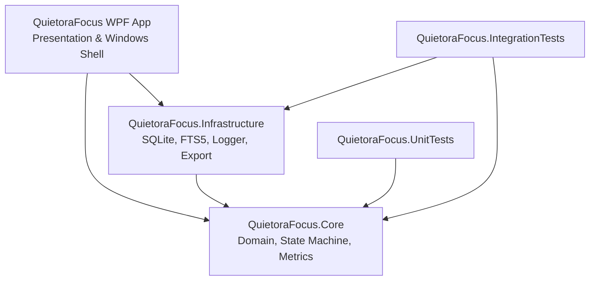
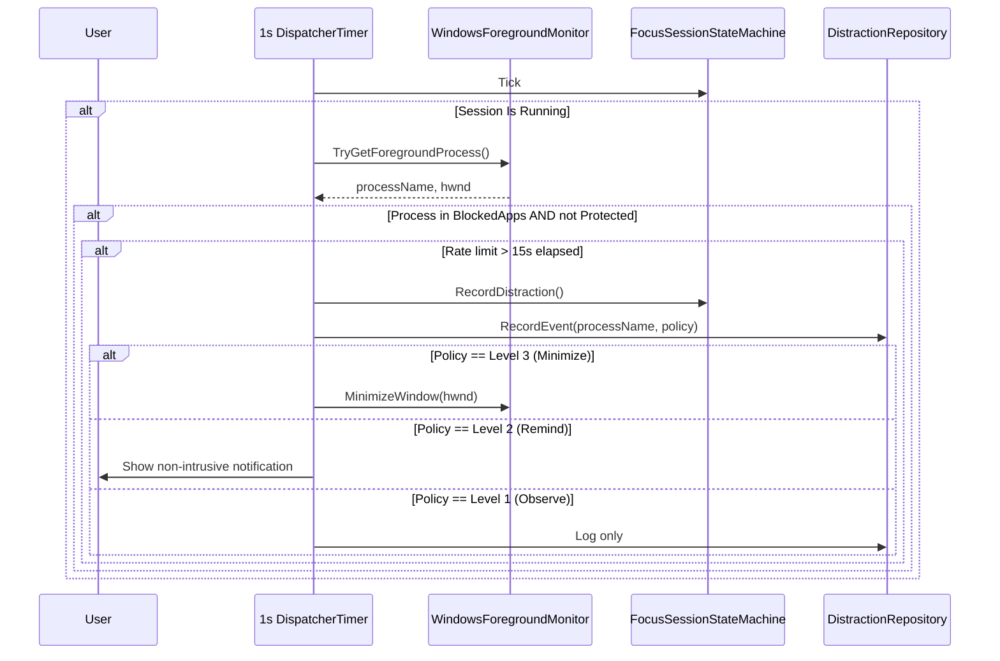

# Quietora Focus v2.0 — Architecture Specification

## 1. Architectural Principles

Quietora Focus v2.0 is designed as a **privacy-first, local-first Windows desktop application**. It adheres strictly to the following principles:

1. **Separation of Concerns:** Business rules, domain state transitions, data access, and user interface presentation are separated into clean, modular assemblies.
2. **Offline Autonomy:** The core software has zero network dependencies. All persistence and search indexing rely on on-device SQLite.
3. **Resilient Data Migrations:** Forward-compatible schema versioning ensures user data created in earlier versions (such as the v0.1.1 baseline) is seamlessly preserved.
4. **Monotonic Timing:** Session elapsed time calculations utilize high-resolution monotonic timestamps (`Stopwatch` + UTC anchors) rather than fragile UI timer ticks.
5. **Non-Intrusive Focus Safeguards:** Interventions must never compromise system stability, steal keyboard focus destructively, or bypass Windows security boundaries.

---

## 2. Solution Structure & Dependency Flow



### 2.1 QuietoraFocus.Core (`net10.0`)
Pure domain models and application-agnostic business logic:
- **Models:** `FocusSessionConfig`, `SessionLog`, `FocusTask`, `Project`, `DistractionRule`, `DistractionEvent`, `MemoryFolderConfig`, `IndexedFileItem`, `ProductivityMetrics`, `RuleBasedRecommendation`.
- **Enums:** `SessionMode`, `SessionState`, `PomodoroPhase`, `DistractionPolicyLevel`, `TaskPriority`, `TaskStatusEnum`.
- **Services:**
  - `FocusSessionStateMachine`: Manages session transitions (`Idle`, `Running`, `Paused`, `Completed`, `Stopped`, `EmergencyStopped`), Pomodoro cycle progression, and distraction recording.
  - `StreakCalculator`: Computes current consecutive active days and all-time best streaks.
  - `ProductivityCalculator`: Computes 7-day activity distributions, aggregate metrics, and rule-based insights.

### 2.2 QuietoraFocus.Infrastructure (`net10.0`)
Persistence, indexing, diagnostic logging, and data export:
- **`QuietoraDatabase`:** Manages SQLite connection pooling, WAL mode (`PRAGMA journal_mode=WAL; PRAGMA foreign_keys=ON;`), and automated versioned schema migrations (`schema_migrations` table).
- **Repositories:** `SessionRepository`, `TaskRepository`, `DistractionRepository`, `SettingsRepository`, `ProjectRepository`, `MemoryRepository`.
- **Search & Indexing:** `LocalMemoryIndexer` (bounded asynchronous file reader) and SQLite FTS5 virtual table (`memory_fts`) for full-text search with BM25 ranking and snippet highlighting.
- **Logging:** `AppLogger` provides local thread-safe file logging at `%LOCALAPPDATA%\QuietoraLabs\QuietoraFocus\logs`, strictly scrubbing any sensitive data.
- **Export:** `DataExportService` generates standard CSV files for sessions, tasks, and distractions, as well as human-readable productivity text reports.

### 2.3 QuietoraFocus Presentation (`net10.0-windows`)
Windows Presentation Foundation (WPF) and Windows Desktop Shell integration:
- **MVVM Pattern:** `MainViewModel` binds to XAML views without tight code-behind coupling.
- **Theme System:** `ThemeManager` dynamically modifies application-wide brushes between Fluent Dark and Light themes.
- **Windows Interop:**
  - `WindowsForegroundMonitor`: Win32 P/Invoke wrapper (`GetForegroundWindow`, `GetWindowThreadProcessId`, `ShowWindowAsync`) with protected Windows system process filtering.
  - `StartupManager`: Manages opt-in launch at Windows boot via `HKCU\Software\Microsoft\Windows\CurrentVersion\Run`.
  - `TrayService`: Native Win32 `Shell_NotifyIconW` integration for background presence, double-click window restore, and balloon notifications.

---

## 3. Database Schema & Migration Strategy

Quietora Focus utilizes a versioned migration table `schema_migrations`:

```sql
CREATE TABLE IF NOT EXISTS schema_migrations (
    version INTEGER PRIMARY KEY NOT NULL,
    applied_utc TEXT NOT NULL,
    description TEXT NOT NULL
);
```

### Migration History:
- **Migration 1 (v0.1.1 Baseline):**
  - `blocked_apps (process_name TEXT PRIMARY KEY)`
  - `sessions (id, task, started_utc, ended_utc, planned_seconds, actual_seconds, distractions, end_reason)`
  - `settings (key TEXT PRIMARY KEY, value TEXT)`
- **Migration 2 (v2.0 Advanced Additions):**
  - Safely alter `sessions` table adding `subject`, `project_name`, `mode`, `paused_seconds`, and `notes`.
  - Create `tasks` table with priorities and deadlines.
  - Create `projects` table.
  - Create `distraction_events` table for granular audit logging.
  - Create `memory_folders` and `indexed_files` tables.
  - Create `memory_fts` SQLite FTS5 virtual table for full-text search.

---

## 4. Distraction Management Architecture



---

## 5. Security & Safety Model

1. **Parameterization:** All database queries utilize parameterized SQLite parameters (`$param`), preventing SQL injection.
2. **Process Whitelist Protection:** Vital Windows system executables cannot be blocked or minimized.
3. **No Administrative Rights Required:** Runs entirely under standard user privileges.
4. **Bounded Resource Utilization:** File indexing enforces a 5 MB file size limit, 64 KB read buffer, and respects cancellation tokens.
