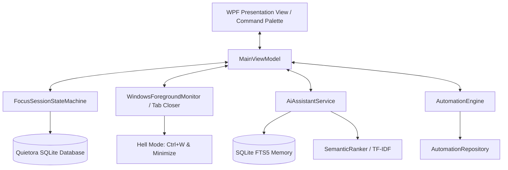

# Architectural Blueprint & Systems Design

## Quietora Focus v3.0 — Intelligence Edition
**Parent Brand:** QuietoraLabs  
**Target Platform:** Windows 10 / Windows 11 (x64)  
**Technology Stack:** C# 14 / .NET 10, WPF, MVVM, SQLite with FTS5, Win32 P/Invoke APIs

---

## 1. System Overview

Quietora Focus is structured around four primary pillars:
1. **Focus Engine & Distraction Interception**: Monotonic state machine managing multi-mode focus cadences and high-velocity distraction blocking (including Hell/Hardcore mode for browser tabs and Incognito sessions).
2. **Personal PC Memory Engine 2.0**: File crawling, multi-format text decoding (Markdown, TXT, PDF, source code), SHA-256 deduplication, and SQLite FTS5 full-text indexing.
3. **Local AI Workspace Assistant**: 100% on-device grounded RAG pipeline combining BM25 full-text retrieval, TF-IDF cosine similarity reranking, and citation generation with prompt-injection defense.
4. **Contextual Work Recovery & Automations**: Directory snapshotting, recent file tracking, and an event-driven trigger-condition-action rule evaluation engine.

---

## 2. Solution Structure

```text
QuietoraFocus.sln
├── src/
│   ├── QuietoraFocus/                 # Presentation & Interop Layer
│   │   ├── Common/                    # ObservableObject, RelayCommand
│   │   ├── Converters/                # ValueConverters for XAML
│   │   ├── Interop/                   # Win32 P/Invoke, Foreground Monitor, Startup
│   │   ├── Services/                  # ThemeManager, TrayService
│   │   ├── ViewModels/                # MainViewModel (MVVM Controller)
│   │   └── MainWindow.xaml            # Modern Fluent UI Layout (10 Workspaces & Command Palette)
│   ├── QuietoraFocus.Core/            # Pure Business Domain
│   │   ├── Models/                    # Session, Task, Memory, AI, Automation Models
│   │   └── Services/                  # FocusSessionStateMachine, StreakCalc, SemanticRanker, AI Assistant
│   └── QuietoraFocus.Infrastructure/  # I/O, Database, Security & Hardware Interop
│       ├── Data/                      # QuietoraDatabase, Migrations 1-4
│       ├── Export/                    # DataExportService (CSV, Text Reports)
│       ├── Indexing/                  # DocumentExtractor, LocalMemoryIndexer
│       ├── Logging/                   # AppLogger (Rolling file appender)
│       ├── Network/                   # HostsFileService (DNS blocking)
│       └── Repositories/              # Session, Task, Website, Memory, Workspace, Automation Repos
└── tests/
    ├── QuietoraFocus.UnitTests/       # Domain and algorithm unit tests
    └── QuietoraFocus.IntegrationTests/# Database, FTS5, and repository integration tests
```

---

## 3. Data Flow & Subsystems



---

## 4. Architectural Patterns & Decisions

- **MVVM Pattern**: ViewModels maintain application state using `INotifyPropertyChanged` and `ICommand`. Views contain zero business logic.
- **Dependency Isolation**: `QuietoraFocus.Core` has zero dependencies on WPF, UI, or SQLite packages, allowing tests to run rapidly on any standard .NET environment.
- **Monotonic Timing**: `FocusSessionStateMachine` uses `Stopwatch` elapsed ticks for delta calculations, preventing system clock tampering or sleep pauses from corrupting records.
- **Zero-Cloud RAG Architecture**: Retrieval-Augmented Generation executes entirely on the local CPU without external API tokens or cloud connections.
