# Database Architecture & Schema Migrations

## Quietora Focus v3.0 — SQLite Specification
**Engine:** SQLite 3 via `Microsoft.Data.Sqlite` 10.0.14  
**Location:** `%LOCALAPPDATA%\QuietoraFocus\quietora.db` (overrideable via constructor)  
**Security:** PRAGMA synchronous = NORMAL; PRAGMA journal_mode = WAL;

---

## 1. Migration History

| Version | Release | Scope | Key Tables / Columns Added |
| :--- | :--- | :--- | :--- |
| **1** | v0.1.1 MVP | Baseline tables | `blocked_apps`, `sessions`, `settings` |
| **2** | v2.0 Advanced | Domain enhancements | `tasks`, `projects`, `distraction_events`, `memory_folders`, `indexed_files`, `memory_fts` (FTS5) |
| **3** | v2.1 Hardcore | Website shield | `blocked_websites`, `distraction_events.target_detail` |
| **4** | v3.0 Intelligence | Workspaces & Automations | `workspace_snapshots`, `automation_rules` |
| **5** | v3.1 Regain Detox | Daily budgets & screen time | `app_budgets`, `screen_time_records` |
| **6** | v4.0 Student OS | Student workspace & shields | `academic_subjects`, `academic_topics`, `academic_assignments`, `academic_exams`, `academic_flashcards`, `detected_games` |

---

## 2. Entity Relationship Diagram

```mermaid
erDiagram
    SCHEMA_MIGRATIONS {
        INTEGER version PK
        TEXT applied_utc
        TEXT description
    }
    SESSIONS {
        INTEGER id PK
        TEXT task
        TEXT subject
        TEXT project_name
        TEXT mode
        TEXT start_time
        TEXT end_time
        INTEGER planned_seconds
        INTEGER actual_seconds
        INTEGER paused_seconds
        INTEGER distractions
        TEXT end_reason
        TEXT notes
    }
    TASKS {
        INTEGER id PK
        TEXT title
        TEXT description
        INTEGER priority
        INTEGER status
        TEXT due_date_utc
        INTEGER project_id
        INTEGER estimated_minutes
        INTEGER actual_minutes
        TEXT created_utc
        TEXT completed_utc
    }
    BLOCKED_WEBSITES {
        TEXT domain PK
        TEXT keyword_pattern
        TEXT display_name
        TEXT category
        INTEGER is_active
    }
    WORKSPACE_SNAPSHOTS {
        INTEGER id PK
        TEXT name
        TEXT project_path
        TEXT description
        TEXT recent_files_json
        TEXT associated_task_ids_json
        TEXT notes
        TEXT saved_utc
    }
    AUTOMATION_RULES {
        INTEGER id PK
        TEXT title
        TEXT description
        INTEGER trigger_type
        TEXT trigger_config
        INTEGER action_type
        TEXT action_payload
        INTEGER is_enabled
        TEXT last_triggered_utc
    }
    INDEXED_FILES {
        INTEGER id PK
        INTEGER folder_id
        TEXT file_path
        TEXT file_name
        TEXT file_extension
        INTEGER size_bytes
        TEXT last_modified_utc
        TEXT indexed_utc
        TEXT content_hash
    }
    APP_BUDGETS {
        INTEGER id PK
        TEXT target_name
        TEXT target_type
        INTEGER daily_limit_minutes
        INTEGER used_today_seconds
        INTEGER is_locked
        INTEGER is_active
        TEXT created_utc
    }
    SCREEN_TIME_RECORDS {
        INTEGER id PK
        TEXT target_name
        TEXT record_date
        INTEGER seconds_spent
        INTEGER doomscroll_attempts
    }
```

---

## 3. Data Integrity & Nuclear Wipe

- **Migration Safety**: Each migration step executes within an isolated SQLite transaction (`tx.Commit()`). If any failure occurs, changes are rolled back cleanly (`tx.Rollback()`).
- **Nuclear Data Wipe**: Users can completely purge all database contents via the Privacy Center. When triggered, Quietora executes foreign key checks, deletes all tables, and re-initializes fresh empty schema migrations in milliseconds.
