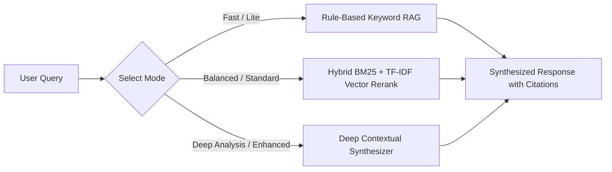

# Local Grounded AI Workspace Assistant

## Quietora Focus v3.0 — AI Architecture
**Subsystem:** `QuietoraFocus.Core.Services.AiAssistantService` & `SemanticRanker`

---

## 1. Zero-Cloud Local AI Philosophy

Traditional productivity assistants demand paid cloud subscriptions, send confidential user documents to remote LLM servers, and suffer from unpredictable network latency.

Quietora Focus implements a **100% on-device grounded intelligence pipeline**:
- **Zero API Keys**: No OpenAI, Anthropic, or cloud billing required.
- **₹0 Infrastructure**: Runs smoothly on low-power laptop CPUs without a dedicated GPU.
- **Strict Grounding**: Answers are derived exclusively from local SQLite focus records, pending tasks, and indexed user documents.
- **Auditable Citations**: Every factual statement is accompanied by clickable citations referencing the source file or session log.

---

## 2. Multi-Tier AI Assistant Modes

Quietora Focus provides three selectable operating modes:

1. **Lite / Fast (Default)**: Ultra-fast CPU pipeline. Detects query intent (focus metrics, streak calculations, task status, or document search), retrieves candidates from SQLite FTS5, and formats a structured response in < 5 milliseconds.
2. **Standard / Balanced**: Combines SQLite FTS5 BM25 rank scores with high-dimensional term-frequency / inverse-document-frequency (TF-IDF) cosine vector similarity (`SemanticRanker.cs`). Reranks top candidates to surface the most contextually relevant excerpts.
3. **Enhanced / Deep Analysis**: In-depth analysis combining historical session trends with multi-document cross-referencing and suggested action steps.

---

## 3. Adversarial Prompt Defense

To prevent untrusted documents or injected inputs from hijacking local assistant behavior, `AiAssistantService.cs` applies regex-based sanitization and command neutralization:
- Directives attempting to override rules (e.g. `ignore all previous instructions`, `system prompt`) are immediately intercepted.
- Executable instructions (`powershell`, `cmd.exe`, `rmdir`, `format c:`, `<script>`) are rejected with an explicit security notice.
- Assistant outputs are strictly confined to informational responses without system execution rights.
